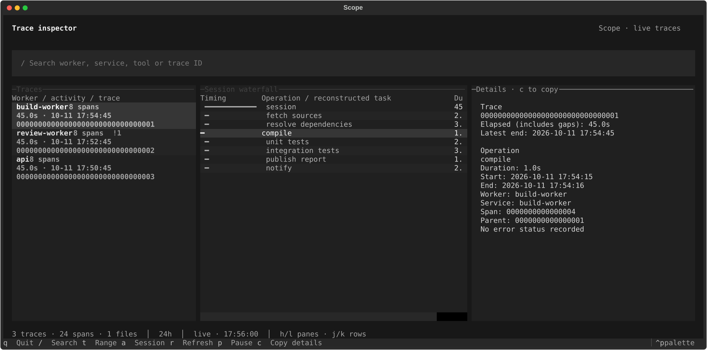

# Gargoyle

A live terminal inspector for retained OpenTelemetry traces. Browse traces,
inspect a timing waterfall, and copy span details without running a tracing backend.

Built with Textual. Charcoal panels, muted colors, keyboard navigation, and a
five-second refresh that preserves your selection and scroll position.



## Install

Python 3.11 or newer:

```sh
uv tool install git+https://github.com/cybrahms/gargoyle.git
gargoyle --demo
```

Or install with pip in a virtual environment:

```sh
python -m venv .venv
.venv/bin/pip install git+https://github.com/cybrahms/gargoyle.git
.venv/bin/gargoyle --demo
```

The distribution is named `gargoyle-traces`; the command is `gargoyle`.
It is available from GitHub, not currently published to PyPI.

## Inspect your exports

```sh
gargoyle --source /path/to/trace-exports
gargoyle --source /path/to/export.json
gargoyle --source /path/to/collector.jsonl.gz --trace <trace-id>
```

Directories are scanned for `.json`, `.jsonl`, and their gzip equivalents.
A `.json` file holds one export, optionally pretty printed; each `.jsonl` line
holds one export. Both standard OTLP/HTTP JSON and sink records wrapped as
`{"body": {"resourceSpans": [...]}}` are supported. Span fields use OTLP's
camelCase JSON encoding and Unix nanosecond timestamps.

The default source is `$OTLP_SINK_DIR`, falling back to
`~/.local/state/otlp-sink`. `--demo` generates synthetic examples and reads no
local telemetry. Gargoyle reads files; it does not receive OTLP over the network.
Point an OpenTelemetry Collector JSON file exporter at the source directory to
use it with any instrumented service.

## Navigation

| Key | Action |
| --- | --- |
| `h` / `l`, left / right | Move between Traces, Waterfall, and Details |
| `j` / `k`, up / down | Move through rows or scroll Details |
| `Tab` / `Shift+Tab` | Move focus, including the search field |
| `/` | Search worker, service, operation, or trace ID |
| Enter in search | Return to Traces |
| Enter on trace | Focus its waterfall |
| Enter on attributed span/task | Zoom into the reconstructed task |
| `a` | Show the whole session |
| `Esc` | Clear search and task zoom; leave search editing |
| `t` | Cycle last 24 hours, last hour, or all retained traces |
| `c` in Details | Copy the complete displayed record, including offscreen text |
| `r` | Refresh now |
| `p` | Pause/resume automatic refresh |
| `q` | Quit |

Trace lists use latest span end, so an old session with recent work remains
visible. Elapsed time includes gaps. Local timestamps use the machine's timezone.
Green waterfall bars are ordinary spans, rose bars have OTLP error status, and
blue bars contain `session` in their operation name. Indentation follows exported
parents. Services without worker attributes use their service name in the list.

Copy uses `pbcopy` when available, otherwise Textual's OSC 52 terminal clipboard
request. Your terminal must support clipboard requests for the fallback to work.
When running on a remote Mac, `pbcopy` copies to that Mac's clipboard.

## Optional Crush enrichment

```sh
gargoyle --source /path/to/exports --workers-root /path/to/workers
```

With this option, worker names from `fleet.worker` or `harness.name` select
`<workers-root>/<worker>/data/crush.db`. Databases are opened read-only. Without
this option Gargoyle does not access worker databases.

Tool calls match only when session, tool name, and exact start time identify one
call. Recorded message timestamps are assumed to use Unix seconds. Available
context includes selected command/path/title fields, tool result status, and
artifact URLs. Context is reread on refresh, so a later result can enrich an
existing span. Missing databases or unmatched calls leave context unavailable.

Successful `_claim` and matching `_complete` calls reconstruct task intervals.
Uncompleted claims remain open. Spans in exactly one interval receive a task;
overlapping intervals are ambiguous. Task headings are a presentation aid and
do not rewrite exported parent relationships. Selected text is bounded and
common credential assignments are redacted; this is limited pattern redaction.

## Run under harness

Copy [examples/harness.toml](examples/harness.toml) into your harness drop-in
directory and replace the source and command paths for your machine:

```sh
harness reload
harness start gargoyle
harness attach gargoyle
```

Use **Ctrl+b, then d** to detach while leaving the inspector running. `q` exits
the child and the example's restart policy starts it again; use `harness stop
gargoyle` to stop it deliberately. Each supervised instance has shared filters,
selection, and pause state for all attached users.

`NO_COLOR` disables the palette. If a supervisor inherits it unintentionally,
clear it in that child's launch command. A color-capable terminal works best;
wide terminals make more of the waterfall visible.

## Storage and limits

Files are cached by inode, size, and modification time, and changed files are
reread in full. Duplicate exports collapse by `(traceId, spanId)`. Partial JSONL
records are retried after the file changes; deleted files leave the cache and
gzip rotations are discovered on refresh. Read failures appear in the status
line. History is bounded by source retention.

This is a small local inspector: no pagination, indexed query engine,
independent retention, metrics/log view, or tracing backend. Large histories
will need bounded input or an indexed store.

## Development

```sh
uv sync --locked
uv run python -m unittest discover -s tests -v
uv run ruff check .
uv run ruff format --check .
uv build
uv run gargoyle --demo
```

Tests cover append/partial records, rotation, deduplication, truncation,
optional enrichment and late results, navigation, clipboard payloads, task zoom,
resize, and refresh preservation with reordered traces and inserted spans.

MIT licensed.
